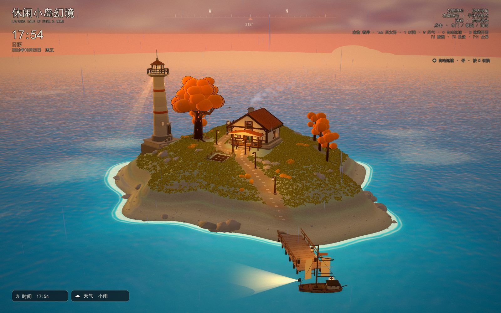
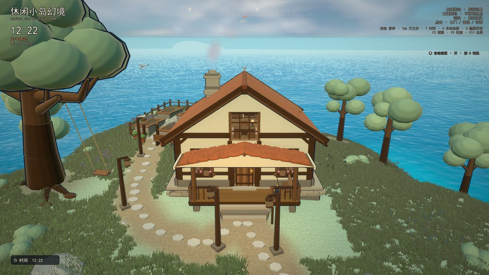
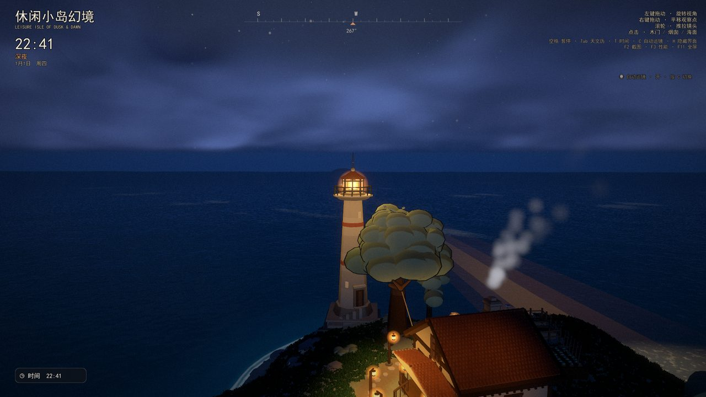
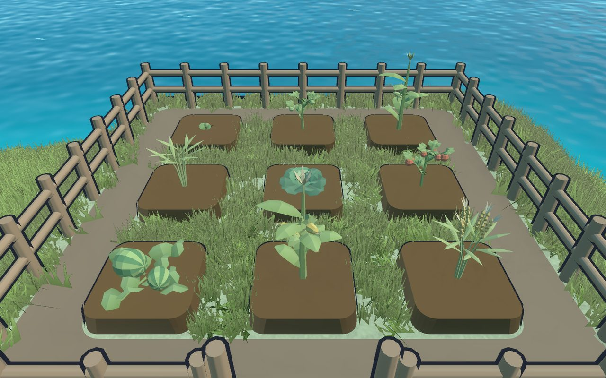

# 休闲小岛幻境 · Leisure Isle of Dusk & Dawn

一座会随真实天文模型走过晨昏、月相与四季的**放松型「放置观景」小岛**。  
用 **Godot 4.7.2（Forward+）** 制作：地形、草木、海面、房屋、灯塔、船只、岛民、天气与音效全部**程序化生成**，不依赖任何外部美术资源（仅内置中文字体，音频为脚本运行时合成）。



## 这是什么

- **没有失败、没有倒计时**：打开就是一座海上的小岛，时间自己走，船会出港返航，鸟会飞会归巢，灯会亮，雨会下，季节会换。
- **一个真实的天文钟**：太阳高度/方位、日出日落、月相与月升月落由天文计算驱动，同时照亮天空、海面、环境色与灯光。
- **可以接进现实**：内置 134 个 IANA 时区（2016–2041 数据，按时间规则分为 61 组），可切换「模拟时间 / 现实时间」，现实时间跟随系统时钟并支持夏令时。
- **P9 生活玩法**：3×3 菜地（5 种作物，按**现实时间**成熟，玉米/番茄可收获 3 次）、近岸钓鱼（6 种鱼）、背包与物品、世界存档、岛民日程与睡觉/吃饭/坐秋千等完整动作链。

## 截图

<table>
  <tr>
    <td></td>
    <td></td>
  </tr>
  <tr>
    <td align="center">正午的小屋、花园与码头</td>
    <td align="center">深夜的灯塔光束与海面扫光</td>
  </tr>
  <tr>
    <td></td>
    <td></td>
  </tr>
  <tr>
    <td align="center">P9 菜地：5 种作物与成熟/再生</td>
    <td align="center">黄昏：灯塔、炊烟、出港的船</td>
  </tr>
</table>

## 快速开始

### 方式 A：源码运行（推荐）

1. 安装 **Godot 4.7.2**（标准版即可，选 Forward+ 渲染器）；
2. 克隆本仓库，用 Godot 打开 `project.godot`，按 **F5**；
3. 或用命令行直接运行（在仓库根目录执行）：

```bat
Godot_v4.7.2-stable_win64.exe --path . --resolution 1440x900
```

> 首次启动会显示标题界面（电影画幅 + 环绕运镜）。点「开始游戏」进入自由观景。

### 方式 B：直接游玩

在 [Releases](../../releases) 下载打包好的 `休闲小岛幻境.exe`（单文件，内置 pck，约 112 MB），双击即可运行，无需安装 Godot。

**环境要求**：Windows 10/11 + 支持 Vulkan / D3D12 的桌面 GPU。未针对移动端或集显做降级适配。

## 操作

| 输入 | 行为 |
| --- | --- |
| 左键拖动 | 旋转视角（绕岛） |
| 右键拖动 | 平移观察点（受约束，不穿墙不入地） |
| 滚轮 | 推拉镜头（9–240 m，近景下限 9 m） |
| 点击木门 / 烟囱 / 海面 | 开关门 / 炊烟 / 涟漪水花（累计 5 次触发小鱼跃出） |
| R | 切换「模拟时间 / 现实时间」 |
| 空格 | 暂停 / 继续模拟时间（现实时间模式不可暂停） |
| Tab | 天文历（日出日落、月相、月升月落） |
| T | 展开 / 收折 24 小时时间面板（可拖动时间轴） |
| [ / ] | 微调时间（仅模拟时间） |
| 1–5 | 跳转清晨 / 正午 / 黄金时刻 / 日落 / 夜晚（仅模拟时间） |
| H | 隐藏 / 显示界面 |
| F2 / F3 / F11 | 截图 / 性能叠层 / 全屏 |
| Esc | 返回标题 / 关闭面板 |

## 模拟与玩法系统

- **单一可信时钟**：天文、天空、海面、船、鸟、炊烟、灯光、天气、作物生长共用同一时间源；暂停、快进、跨日不影响任何子系统的一致性。
- **天文**：太阳高度/方位、日出日落、月相与月升月落（广州纬度）；驱动天空、水面、环境色与月相变化。
- **现实时间 + 时区**：134 个 IANA 时区、可搜索、按当前日期实时计算偏移并标注 DST；HUD、天文历、天空日月共用同一时间源。
- **生态与生活**：大船 8 条随机往返航线（弧长参数化、平滑转向、尾迹）、10 只海鸥的栖枝预订与归巢、6–8 盏夜间局部点光、萤火虫、炊烟、秋千；岛民按日程活动。
- **天气与季节**：晴/阴/雨/雾等天气与四季，影响天空、光照、雾、作物生长与音效。
- **P9 种田/钓鱼/背包/存档**：`isle_crops.gd`（5 作物：小麦、玉米、西瓜、番茄、羽衣甘蓝）、`isle_farm.gd`、`isle_fish.gd`（6 鱼）、`isle_inventory.gd`（共享库存原子事务）、`isle_save.gd`（世界存档）。
- **程序化渲染**：自定义 toon / 天空 / 海面 / 玻璃 / 草 / 灯塔光束 shader；三层云、多尺度星空与银河、5 组定向波 + 双层噪声细节法线、约 2 万株 MultiMesh 草；后处理暗角/色彩/辉光；画质三档（MSAA、渲染比例、云层、水面、灯光预算 4/6/8、草量、粒子）。

## 项目结构

```text
project.godot          项目配置（1440x900 / Forward+ / MSAA）
isle.tscn              主场景（挂 main.gd）
scripts/
  main.gd              主循环：相机、昼夜、灯光、输入、现实时间、灯塔光束、航线状态机、HUD 接线
  world.gd             地形、海面/岸边、树木、花园、岩石、花、灯塔、航线与大船、码头、栖枝
  cottage.gd           小屋：分段墙体与真实洞口、屋顶、门窗、阁楼落地窗与室内、门廊台阶、灯光
  isle_math.gd         几何与程序化材质 helper
  isle_astro.gd        太阳/月亮天文计算
  isle_time.gd         IANA 时区服务（列表/解析/搜索/偏移/换算）
  isle_tz_data.gd      134 个 IANA 时区偏移表（由 tools/gen_tz_data.py 生成）
  isle_palette.gd      昼夜调色板与主题插值
  isle_season.gd       季节
  isle_weather.gd      天气系统
  isle_weather_fx.gd   天气表现
  isle_crops.gd        P9 作物规则与生长
  isle_crop_models.gd  P9 作物模型
  isle_farm.gd         P9 菜地交互
  isle_farm_view.gd    P9 菜地表现
  isle_fish.gd         P9 鱼群
  isle_fishing_rig.gd  P9 钓具与钓鱼流程
  isle_inventory.gd    P9 背包与共享库存
  isle_save.gd         P9 世界存档
  isle_villager*.gd    岛民模型/日程/状态机
  fx.gd                粒子/涟漪/水花/尾迹/鸟群状态机
  hud.gd               HUD、天文历、时间面板、性能叠层
  menu.gd              标题界面、设置、时区搜索、电影画幅转场
  ui_*.gd              自绘滑条、时间轴、日期时间滚轮
shaders/               全部自定义 shader
audio/                 运行时合成的环境音与音效
docs/                  各阶段报告、测试结果、已知问题与截图
tools/                 探针（自动化验证脚本）与数据生成脚本
addons/godot_ai/       Godot AI MCP 插件（开发工具，不影响游戏运行）
```

## 自动化验证

工程内置探针与自测入口（详见 `docs/`）：

```bat
:: 窗口自测（73/73 通过）
Godot_v4.7.2-stable_win64_console.exe --path . -- --selftest

:: 一键截图 / 性能基准
... --path . -- --shots
... --path . -- --perf

:: 单个探针（headless）
... --headless --path . --script res://tools/probe_world_p5.gd
```

## 开发历程

项目按阶段推进，每阶段都有计划、报告与测试结果留档（见 `docs/`）：

| 阶段 | 主题 |
| --- | --- |
| P3 | 程序化渲染与场景生成 |
| P4 | 现实时间 + 时区、灯塔、船与鸟群、小屋重做 |
| P5 | 时间面板、海鸥、玻璃 PBR、船只生命周期 |
| P6 | 天文精度、音频、性能与工程卫生收尾 |
| P7 | 黄昏归栖、岛民与自主日常 |
| P8 / P8.1 / P8.2 | 天气、季节、月相、生态，以及画质/性能/UI 精修 |
| P9 / P7-FINALIZE | 菜地真实时间成长与三次收获、钓鱼、背包、世界存档、设置持久化、小鸟运动学、睡觉/吃饭动作链（料理前置评估中） |

## 已知限制

- 仅 Windows 桌面；需要支持 Forward+ 的 GPU，未适配移动端/集显；
- 只有中文界面，无手柄支持；
- 时区表覆盖 2016–2041，表外时刻按最近偏移延用，之后规则变更需重跑 `tools/gen_tz_data.py`；
- 现实时间模式为只读时钟；天文仍固定广州纬度；
- 音频为程序合成的占位级素材；玻璃折射为屏幕空间近似，灯塔表面受光为解析锥近似；
- 退出时仍有少量 ObjectDB / RID 告警（收尾噪音，不影响运行期）。

更完整的限制与验证数据见 `docs/OPEN_ISSUES.md` 与各阶段报告。

## 许可证

本项目采用 [MIT License](LICENSE) 开源（Copyright © 2026 SAMY0913）。可自由使用、修改与分发，保留版权与许可声明即可。
